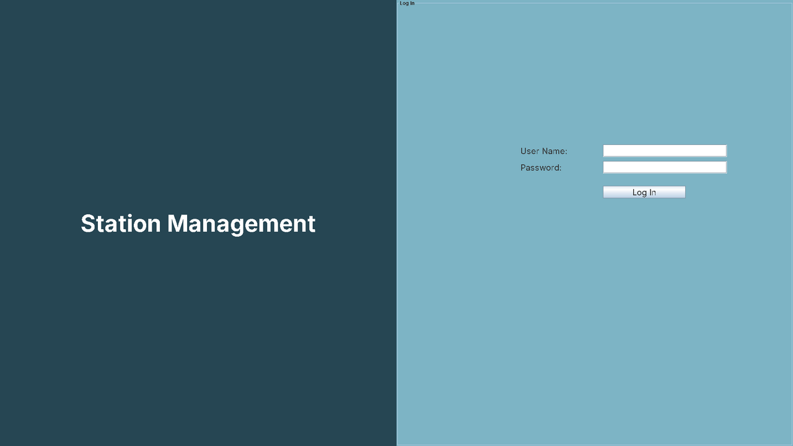
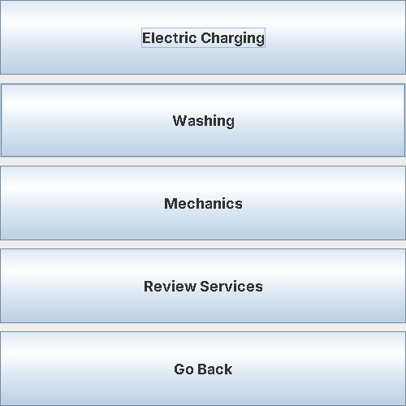
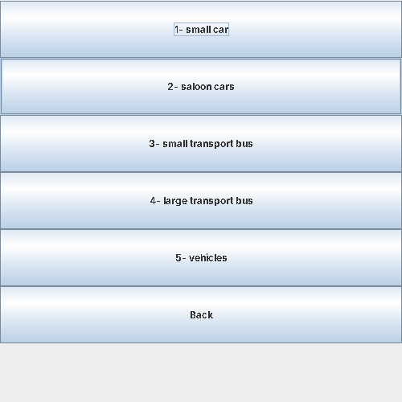
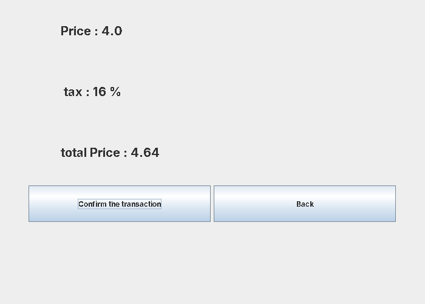
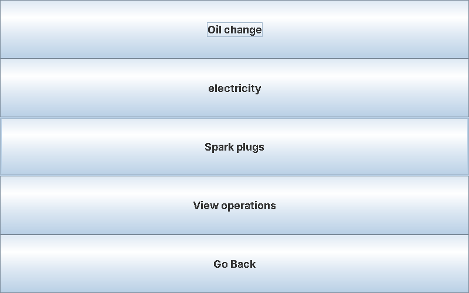
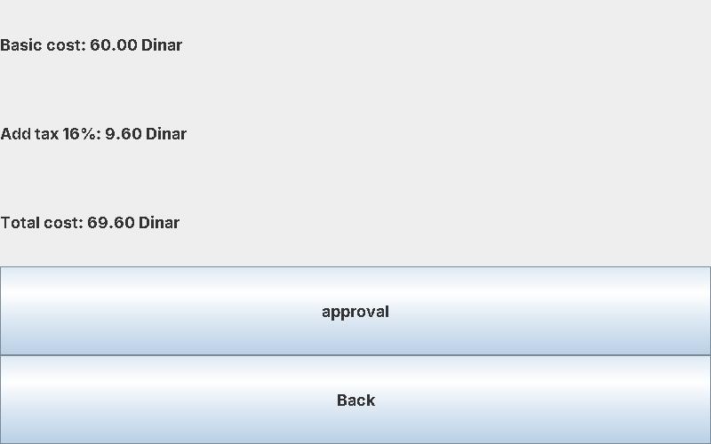

# ⛽ Station Management System

A **Java Swing** desktop application for managing a service station: **electric car charging**, **car washing** and **mechanical services**, with cost calculation, taxes, discounts and a history of all operations.


<p align="center">
  
</p>

## ✨ Features

| Module | What it does |
|---|---|
| 🔐 **Login** | Username/password check with **3 attempts**; the app closes after the third wrong attempt |
| 🔋 **Electric Charging** | Enter the number of kilowatts → cost at **8 Dinar/kW**, with a discount of 1 Dinar/kW from 50 kW and 2 Dinar/kW from 60 kW |
| 🚿 **Washing** | Choose a vehicle type (small car → large bus), see the price, **16% tax** and total, then confirm |
| 🔧 **Mechanics** | Oil change (by kilometers and oil type), headlight / tail light repair and spark plugs, all with **16% tax** |
| 📜 **Review Services** | Shows the history of all confirmed operations in one window |

Input is validated (empty, non-numeric and non-positive values show an error message).

## 🖼️ Screenshots

| Service selection | Washing | Washing cost |
|---|---|---|
|  |  |  |

| Mechanical services | Service cost | Electric charging |
|---|---|---|
|  |  |  |

## 🧱 Project Structure

```text
src/stationmanagement/
├── StationManagement.java   # Main window, login and service selection menu
├── ElectricCharging.java    # Charging cost, discounts and charging history
├── Washings.java            # Washing prices by vehicle type and wash history
├── Mechanic.java            # Mechanical services (CardLayout screens) and transactions
└── PrintDialog.java         # Reusable dialog for displaying operation history
```

**Concepts used:** classes & objects, constructors, inheritance (`extends JFrame` / `JDialog`), method overriding (`toString`), arrays & `ArrayList`, lambda event listeners, exception handling, and Swing layouts (`GroupLayout`, `GridLayout`, `CardLayout`, `BorderLayout`).

## 🚀 How to Run

**NetBeans:** *File → Open Project* → select this folder → *Run*.

**Terminal (Java 8 or newer):**

```bash
javac -encoding UTF-8 -d out src/stationmanagement/*.java
java -cp out stationmanagement.StationManagement
```

**Demo login:** username `admin` · password `1234`

> Optional: put an image named `background.jpg` inside `src/stationmanagement/` to show it on the login screen. Without it, the app shows the program name instead.

## 👤 Author

**Haitham Hani Dalloul** –
Java training project – Al-Azeema for Management Consulting and Training
